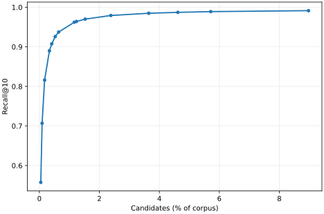
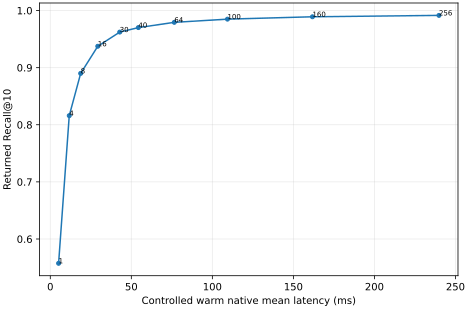
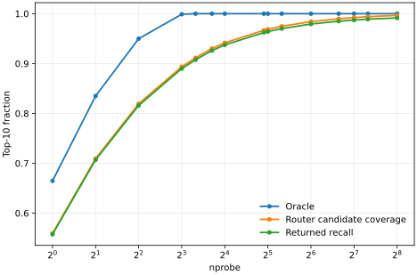

# Phase G2: probe depth on the synchronized Qdrant 1.19.2 LMI

## Research question

For one fixed, persisted 10.12M-vector LMI state, how do additional router-ranked buckets change returned Recall@10, candidate work, and search latency? At what probe depths do gains diminish, and which loss remains: the corpus partition, router ordering, or scoring and output?

This study treats `nprobe` as a query-time control. It does not train a new router, rebuild postings, or alter the Qdrant production implementation.

## Prior work and what this study adopts

- [Procházka et al., *Scaling Learned Metric Index to 100M Datasets*](https://link.springer.com/chapter/10.1007/978-3-031-75823-2_22), available in full as Appendix B of [Procházka, *Scalable Learned Indexing for Complex Data*](https://www.researchgate.net/publication/396155356_Scalable_Learned_Indexing_for_Complex_Data), study 100M 768-dimensional CLIP vectors with 10,000 buckets. The challenge asks for 30 neighbors over 10,000 concurrently issued queries using inner product. Task 1 retains 768 dimensions and chooses the fastest setting meeting 0.8 recall under a 12-hour build limit: P=4 gives 81.3%, and the published curve exceeds 96% around P=30. Task 2 has eight CPUs, 32 GB RAM and disk-resident source vectors; it searches a 135-dimensional representation, then refines 1,000 candidates using full vectors read from disk, and needs P=40 for 80.0%. These are different tasks, scoring paths and resource regimes. We adopt probe-count stop conditions, target-recall operating points and cost-benefit analysis, but normalize P/B and directly measure candidates/N rather than infer cost from P.
- [Procházka, *Scalable Learned Indexing for Complex Data*](https://is.muni.cz/th/lbgpn/) explains the transition from the SISAP-2023 10M prototype to sampled training, approximately square-root-of-N bucket counts, spherical clustering, and storage-aware search. We use that scaling rationale as context while freezing one trained 10.12M state; this study is query-only and cannot estimate training variability.
- [Slanináková et al., *SISAP 2023 Indexing Challenge – Learned Metric Index*](https://link.springer.com/chapter/10.1007/978-3-031-46994-7_24) and its [SISAP poster](https://www.sisap.org/2023/posters/6820.pdf) describe the earlier 10M challenge architecture with 122 categories and PCA guidance. Probing about four to five of those categories corresponds to roughly 3.3–4.1% of that partition count. We include P=128 and 160, about 4.0–5.1% of our 3,162 buckets, as architectural anchors only; training, posting populations and retrieval path differ.
- [Slanináková et al., *Reproducible experiments with Learned Metric Index Framework*](https://www.sciencedirect.com/science/article/abs/pii/S0306437923000911) bundle Python libraries, YAML configurations, JSON ground truth and a Docker image, then discuss weak reproducibility as preserving result order and scientific conclusions despite numerical differences. We preserve hashes, raw query rows, probe order, seeds and commands; we compare the historical Phase G curve by ordering and shape as well as numerical differences.
- [Slanináková et al., *On the Costs and Benefits of Learned Indexing for Dynamic High-Dimensional Data*](https://arxiv.org/abs/2507.05865) motivates a later dynamic cost question. It is contextual only; G2 neither updates the index nor implements adaptive routing.

## Fixed state and provenance

The implementation branch is `thesis/lmi-qdrant-sync`; HEAD and the annotated tag `thesis-lmi-qdrant-1.19.2-pre-g2-2026-10-07` point to `977ef25150f71e3bc0cbedc4ea37b7539e15b2bb`. The accepted v3 target is in `/home/nicoo/work/lmi-sisap2023-storage/10m-f16-qdrant-119-sync-attempt2/collection/0/segments/168c6d29-9024-404e-aff5-184913f584e7/vector_index`.

| State file | SHA-256 |
|---|---|
| `lmi_state.json` | `09c88623def82515b50ddf4f1c85d82a1188e5a29bafbc4fb00ca729dbf8d81f` |
| `lmi_router.bin` | `6789b1aace656c3c475675041433ccdb97bd13190d15edc8ff2b7c0bf8708a94` |
| `lmi_postings.bin` | `adcf9f104ef60899e9b922e0bbb155061af3a61532fdcf11705ed55340a7eade` |

The collection stores 10,120,191 vectors of dimension 768, Cosine distance and Float16 storage. LMI uses 3,162 buckets, a 512-wide MLP, a 250,000-point training sample, five spherical KMeans iterations, 30 MLP epochs, batch sizes 256, and seed 42. The accepted nprobe=4 baseline returned Recall@10 0.8159318637 with 17,639.65982 mean candidates.

The source HDF5 MD5 values, independently verified in the pre-G2 preflight record, are c05e4b1d2b2a0c7663ac9767753e25e1 for the 10M corpus, 257b9eb3f7f25776e0d33b22451b7b32 for the public 10K queries, and 45b05e4d60b8a66088b378ae7e0d278f for the official gold. The query and gold HDF5 SHA-256 values are 03a6cbbf6722b02c7a294ebf673cd4fec3f3fea97cde9dcdda997c72665044a2 and 528260b78893abac2e8345b192b607cea183734b2ae22af4d752cdc4fa5dc404. The prepared measured-query and measured-gold files have SHA-256 1693d873816217cbcca29dba031443497c0158372c8b622428aa11f3ae4ef992 and 5fb899b0d7993c983e8aaa8937793e74bd839ea05d4ed49d3aba73f6ae9d702a. The G2 provenance files in the result directory preserve machine and input details. All conditions use the same persisted generation; each verifies the three state hashes before and after.

## Protocol

The primary fixed grid is `P ∈ {1,2,4,8,10,13,16,30,32,40,64,100,128,160}`. P=1,10,13,32 approximate the 100M reference probe fractions 4/10,000, 30/10,000, 40/10,000, and 100/10,000. P=128 and 160 represent approximately 4% and 5% of our buckets. These are normalization anchors, not direct equivalents.

For every fixed point, rows 0–19 are warmup and rows 20–9,999 are measured. The harness opens the same v3 router and postings, selects the top-P router-ranked bucket prefix in memory, and passes the resulting candidate offsets to Qdrant's existing `score_candidates` path. It uses the official one-based external IDs and top-10 gold overlap. Raw per-query records contain P, row, returned recall, candidates, candidate gold coverage, oracle coverage, native latency, returned IDs, gold-bucket router ranks, and fragmentation. Direct P=4 parity was checked against all 9,980 accepted baseline candidate counts and returned ID sets.

For each query, let O(P) be the fraction of gold top-10 points in the best P corpus buckets by oracle choice; G(P) the fraction in the router's selected candidate postings; and R(P) the fraction of returned top-10 IDs in the official gold. We report partition loss `1−O`, router loss `O−G`, and output loss `G−R`. This reproduces the Phase G analytic definitions. G is an upper bound on returned recall and is never substituted for R. Because each query has ten gold neighbors, O(P) equals one for P ≥ 10 by construction: zero oracle partition loss at high P does not prove that the learned partition is intrinsically good. At those depths, O−G measures how far the router ranks gold-bearing buckets below the selected prefix, while G−R includes native scoring, representation, and gold-tie effects.

Full-grid native latency records retain cold/cache order effects and are not used as the principal cross-P timing comparison. The controlled panel retains 1,000 deterministic query IDs from rows 20–9,999, uses rows 20–39 as a fixed 20-query warm prefix before each condition, and records three seeded permutations of a 15-setting design. The executed representative ten-point subset is P={1,4,8,16,30,40,64,100,160,256}, with the original relative order retained in each of three repetitions. The first 200 measured panel queries are excluded from the pre-specified warmed-suffix summary; all 1,000 measurements remain in the raw JSONL and full-panel summaries. The preferred mean, p50, p95 and p99 are the medians of the three warmed-suffix run statistics, with the run range reported separately. The same 800 suffix query IDs are compared across every condition.

The native timer starts after query bytes are decoded and the query vector is preprocessed for cosine distance. It includes router top-bucket inference, posting union and deduplication, Qdrant candidate scoring and top-10 selection. It excludes segment opening, query preprocessing, and result serialization. The scorer follows candidate_scoring through BatchFilteredSearcher and RawScorer, including Qdrant visibility checks and Float16 vector reads. The panel runs without another scoring experiment concurrently. Measurements run on an Intel Core Ultra 9 285H with 16 exposed logical CPUs, 23 GiB of WSL2 memory, Ubuntu 26.04, Linux 6.18.33.2, and Rust 1.98.0; full details are recorded in the environment file. HTTP end-to-end latency is not measured because exposing query-time nprobe through HTTP would require a production API change.

## Primary fixed-P results

All 15 completed fixed conditions have 9,980 measured queries. The table separates the oracle (O), routed-candidate coverage (G), and actual returned Recall@10 (R). Candidate work is the number of distinct point offsets passed to the native scorer. Loss columns are 1−O, O−G, and G−R. All values come from the independently checked raw rows; timing is reported from the controlled panel below.

| P | P/B (%) | R | G | O | Mean candidates | C/N (%) | Partition loss | Router loss | Output loss |
|---:|---:|---:|---:|---:|---:|---:|---:|---:|---:|
| 1 | 0.0316 | 0.557475 | 0.559339 | 0.664639 | 4,802.0 | 0.0474 | 0.335361 | 0.105301 | 0.001864 |
| 2 | 0.0633 | 0.706824 | 0.709289 | 0.834900 | 9,219.6 | 0.0911 | 0.165100 | 0.125611 | 0.002465 |
| 4 | 0.1265 | 0.815932 | 0.819158 | 0.949880 | 17,639.7 | 0.1743 | 0.050120 | 0.130721 | 0.003226 |
| 8 | 0.2530 | 0.889900 | 0.893657 | 0.998828 | 33,893.6 | 0.3349 | 0.001172 | 0.105170 | 0.003758 |
| 10 | 0.3163 | 0.907635 | 0.911523 | 1.000000 | 41,833.7 | 0.4134 | 0.000000 | 0.088477 | 0.003888 |
| 13 | 0.4111 | 0.926032 | 0.930130 | 1.000000 | 53,598.6 | 0.5296 | 0.000000 | 0.069870 | 0.004098 |
| 16 | 0.5060 | 0.937425 | 0.941633 | 1.000000 | 65,129.7 | 0.6436 | 0.000000 | 0.058367 | 0.004208 |
| 30 | 0.9488 | 0.962244 | 0.966814 | 1.000000 | 117,819.6 | 1.1642 | 0.000000 | 0.033186 | 0.004569 |
| 32 | 1.0120 | 0.964128 | 0.968737 | 1.000000 | 125,194.1 | 1.2371 | 0.000000 | 0.031263 | 0.004609 |
| 40 | 1.2650 | 0.970090 | 0.974790 | 1.000000 | 154,481.1 | 1.5265 | 0.000000 | 0.025210 | 0.004699 |
| 64 | 2.0240 | 0.979289 | 0.984098 | 1.000000 | 241,205.4 | 2.3834 | 0.000000 | 0.015902 | 0.004810 |
| 100 | 3.1626 | 0.984880 | 0.989840 | 1.000000 | 369,088.6 | 3.6471 | 0.000000 | 0.010160 | 0.004960 |
| 128 | 4.0481 | 0.987174 | 0.992184 | 1.000000 | 467,252.8 | 4.6170 | 0.000000 | 0.007816 | 0.005010 |
| 160 | 5.0601 | 0.989028 | 0.994078 | 1.000000 | 578,255.0 | 5.7139 | 0.000000 | 0.005922 | 0.005050 |
| 256 | 8.0961 | 0.991453 | 0.996573 | 1.000000 | 908,180.2 | 8.9739 | 0.000000 | 0.003427 | 0.005120 |

At P=4, O=0.949880, G=0.819158, and R=0.815932: the 0.130722 router gap dominates the 0.050120 oracle loss and 0.003226 output gap. At P=256, router loss is 0.003427 and output loss is 0.005120; the output component is then larger. Since O becomes one by construction at P≥10, its flat high-P line is a definition-bound ceiling rather than evidence of a perfect partition.

## Stop conditions, frontier, and marginal cost

The following are the smallest tested settings reaching each mean returned-recall target. They are discrete measured choices, with no interpolation.

| Recall target | First P | Mean candidates | Candidate fraction (%) |
|---:|---:|---:|---:|
| 0.800 | 4 | 17,639.7 | 0.1743 |
| 0.850 | 8 | 33,893.6 | 0.3349 |
| 0.900 | 10 | 41,833.7 | 0.4134 |
| 0.950 | 30 | 117,819.6 | 1.1642 |
| 0.960 | 30 | 117,819.6 | 1.1642 |
| 0.970 | 40 | 154,481.1 | 1.5265 |
| 0.980 | 100 | 369,088.6 | 3.6471 |
| 0.985 | 128 | 467,252.8 | 4.6170 |
| 0.990 | 256 | 908,180.2 | 8.9739 |

Every measured point lies on the mean-recall versus mean-candidate Pareto frontier: higher P increases both returned recall and candidate work. The endpoint-chord method gives a descriptive candidate-fraction knee at P=16. This geometric label is sensitive to the measured endpoints and does not select an operating point for every workload.

| Transition | ΔRecall (percentage points) | ΔMean candidates | Recall points per 10,000 extra candidates |
|---:|---:|---:|---:|
| 1→2 | 14.9349 | 4,417.6 | 33.8076 |
| 2→4 | 10.9108 | 8,420.0 | 12.9582 |
| 4→8 | 7.3968 | 16,253.9 | 4.5508 |
| 8→10 | 1.7735 | 7,940.1 | 2.2336 |
| 10→13 | 1.8397 | 11,764.9 | 1.5637 |
| 13→16 | 1.1393 | 11,531.0 | 0.9880 |
| 16→30 | 2.4820 | 52,690.0 | 0.4711 |
| 30→32 | 0.1884 | 7,374.4 | 0.2554 |
| 32→40 | 0.5962 | 29,287.0 | 0.2036 |
| 40→64 | 0.9198 | 86,724.4 | 0.1061 |
| 64→100 | 0.5591 | 127,883.2 | 0.0437 |
| 100→128 | 0.2295 | 98,164.2 | 0.0234 |
| 128→160 | 0.1854 | 111,002.2 | 0.0167 |
| 160→256 | 0.2425 | 329,925.2 | 0.0073 |

The local gain falls from 4.551 recall points per 10,000 extra candidates over P=4→8 to 0.00735 over P=160→256. P=4→256 raises mean candidate work about 51.5-fold for 17.55 additional recall points. This demonstrates diminishing average returns without implying that P=256 is unsuitable when 0.99 recall is required.

Paired query-level 95% bootstrap intervals use 2,000 resamples, seed 20261009. They describe uncertainty over this fixed query set and trained index, not variation across training seeds or corpora.

| Comparison | ΔRecall (percentage points), 95% interval | ΔCandidates, 95% interval |
|---:|---:|---:|
| 4→8 | 7.3968 [7.1402, 7.6644] | 16,253.9 [16,148.8, 16,362.5] |
| 8→16 | 4.7525 [4.5461, 4.9629] | 31,236.1 [31,078.8, 31,392.4] |
| 16→30 | 2.4820 [2.3356, 2.6303] | 52,690.0 [52,447.0, 52,918.2] |
| 30→40 | 0.7846 [0.7154, 0.8587] | 36,661.4 [36,484.6, 36,844.3] |
| 40→100 | 1.4790 [1.3758, 1.5872] | 214,607.5 [213,921.1, 215,272.3] |
| 100→160 | 0.4148 [0.3637, 0.4669] | 209,166.4 [208,507.2, 209,834.3] |
| 160→256 | 0.2425 [0.2044, 0.2816] | 329,925.2 [329,108.0, 330,783.7] |

The controlled latency panel below supplies measured ΔL and recall gain per added millisecond only for its benchmarked probe pairs. Sequential fixed-sweep timing is retained as a cold/cache diagnostic and is not pooled into the cross-probe latency frontier.

## Controlled native latency panel

The panel completed 30 of 30 conditions: three repetitions for each of ten representative P values. Every repetition used the same 1,000 deterministic query IDs and its registered probe order. The table uses the median of the three run statistics on the prespecified final 800 query IDs. Candidate mean and p95 refer to those same 800 IDs. The run range is the minimum and maximum warmed mean across repetitions. The five fixed-grid values P=2,10,13,32,128 have effectiveness measurements but no controlled latency estimate.

| P | Warm mean ms | Warm p50 ms | Warm p95 ms | Warm p99 ms | Run mean range ms | Mean candidates | Candidate p95 |
|---:|---:|---:|---:|---:|---:|---:|---:|
| 1 | 5.129 | 4.987 | 7.574 | 9.330 | 4.199–5.240 | 4,815.0 | 8,807.5 |
| 4 | 11.697 | 11.550 | 15.833 | 17.338 | 10.808–11.929 | 17,491.7 | 27,003.6 |
| 8 | 18.747 | 18.738 | 24.231 | 28.281 | 16.732–19.089 | 33,675.3 | 48,544.0 |
| 16 | 29.308 | 29.249 | 36.498 | 40.438 | 26.332–44.928 | 64,951.3 | 88,743.1 |
| 30 | 42.852 | 42.806 | 52.389 | 59.293 | 41.864–45.679 | 117,560.2 | 154,770.7 |
| 40 | 54.351 | 54.290 | 66.643 | 74.633 | 49.715–54.818 | 154,076.8 | 203,040.5 |
| 64 | 76.517 | 76.698 | 94.822 | 104.036 | 73.882–77.182 | 240,555.9 | 311,243.6 |
| 100 | 109.327 | 109.677 | 135.253 | 146.647 | 108.005–110.810 | 367,998.1 | 469,120.5 |
| 160 | 161.761 | 162.615 | 194.343 | 210.151 | 155.834–162.325 | 577,309.9 | 712,963.3 |
| 256 | 239.828 | 240.709 | 284.265 | 302.897 | 227.303–241.674 | 906,614.5 | 1,101,626.1 |

The first P=16 condition exposed startup cache effects: its full 1,000-query mean was 420.757 ms, its final-800 mean 44.928 ms, and its final-200 mean 30.483 ms. Later P=16 full means were 29.225 and 26.334 ms. The prespecified 800-query suffix mitigates but does not erase this effect; the P=16 run range is visibly wider. Full-panel distributions remain in the analysis JSON and raw rows. Segment opening, initial query decode and cosine preprocessing are outside the timer. No other candidate-scoring experiment ran concurrently.

All ten timed points are on the measured mean-recall versus warm-mean-latency Pareto frontier; the endpoint-chord knee is P=16. P=4 returns 0.81593 recall in 11.697 ms; P=30 returns 0.96224 in 42.852 ms; P=100 returns 0.98488 in 109.327 ms; P=256 returns 0.99145 in 239.828 ms. These are native segment times on this WSL host, not HTTP service times.

Paired latency differences below use the median across repetitions for each shared warmed query, then bootstrap the 800 paired query differences 2,000 times. The intervals are conditional on the three recorded runs; the run ranges above separately expose between-run cache and system variation.

| Comparison | Paired warm latency Δ ms | 95% query bootstrap interval ms |
|---:|---:|---:|
| 4→8 | 6.850 | 6.713–6.990 |
| 8→16 | 10.761 | 10.576–10.940 |
| 16→30 | 13.981 | 13.744–14.192 |
| 30→40 | 10.523 | 10.310–10.736 |
| 40→100 | 55.763 | 55.092–56.389 |
| 100→160 | 50.823 | 50.263–51.407 |
| 160→256 | 78.113 | 77.399–78.864 |

For adjacent timed points, the measured mean-latency difference and recall gain per added millisecond are:

| Transition | ΔWarm mean ms | Recall points per added ms |
|---:|---:|---:|
| 1→4 | 6.568 | 3.9350 |
| 4→8 | 7.050 | 1.0492 |
| 8→16 | 10.561 | 0.4500 |
| 16→30 | 13.544 | 0.1832 |
| 30→40 | 11.499 | 0.0682 |
| 40→64 | 22.166 | 0.0415 |
| 64→100 | 32.810 | 0.0170 |
| 100→160 | 52.434 | 0.0079 |
| 160→256 | 78.067 | 0.0031 |

A descriptive query-level linear fit L=α+βC over 24,000 warmed observations gives α=11.892 ms, β=2.523 ms per 10,000 candidates, and R²=0.982. The residual p95 and p99 are 8.555 and 19.459 ms. Mean residuals by point range from −7.98 ms at P=1 to +4.58 ms at P=100; the fit overpredicts small-P latency and is descriptive rather than a constant-cost law. Cache faults and vector access patterns can change the slope outside this measured range.

## Registered high-probe extension decision

The original extension rule triggered P=256 because P=160 had router loss 0.005922, above the registered 0.005 criterion; its P=128→160 returned-recall gain was also 0.001854, above 0.001. The complete P=256 condition adds 0.002425 returned recall (paired 95% interval 0.002044–0.002816) while adding 329,925 mean candidates. Its 9,980-query Rust test took 2,752.64 seconds wall time, including opening and setup; the measured loop took 2,256.29 seconds. The wrapper exit code was one solely because a trailing shell status expression was malformed after the successful test; the test log, complete rows, summary, and hashes passed independent validation.

The earlier plan made a full P=512 conditional on continued meaningful gain and reasonable runtime. The first condition is met by P=160→256. We judged the runtime condition unfavorable: P=256 already scores 8.97% of the corpus per query and consumed about 46 minutes wall time, while a full P=512 run would score a larger candidate superset before the mandatory latency panel. The original plan gave no numeric runtime cutoff, so this is a resource judgment, not a failed quantitative threshold. Existing gold-bucket ranks give an analytic P=512 candidate-coverage estimate of 0.998487, only 0.001914 above P=256 coverage; this does not predict returned recall. We did not run P=512 on the full query set. Its returned Recall@10 remains unknown and is not plotted as an operating point.

## Router depth, fragmentation, and query difficulty

The router rank needed to include the first, fifth, eighth, ninth, and tenth gold neighbor has median 1, 1, 2, 3, and 5, respectively. For all ten, the p90 is 62, p95 is 132.05, p99 is 603.21, and the maximum is 2,432. Thus an average high-recall curve coexists with a long tail of poorly ranked gold-bearing buckets. The mean number of distinct gold-containing buckets is 3.238 (median 3, p95 7). Fragmentation is strongly associated with lower P=4 recall (Spearman ρ=−0.819) and deeper rank to recover all ten neighbors (Spearman ρ=0.897). These are associations, not causal effects of changing the partition. The Spearman association between fragmentation and returned recall weakens from −0.819 at P=4 to −0.582 at P=16, −0.461 at P=30, and −0.163 at P=160, consistent with deeper probing rescuing many fragmented queries.

Define difficulty groups from the accepted P=4 returned recall, then hold query membership fixed. The 756 queries with P=4 recall ≤0.3 improve from mean 0.1926 at P=4 to 0.7967 at P=30 and 0.9468 at P=160 and 0.9636 at P=256. The 2,064 queries at 0.4–0.7 improve from 0.5763 to 0.9272 and 0.9863 at P=160, then 0.9906 at P=256. The 7,160 queries at ≥0.8 improve from 0.9508 to 0.9898 and 0.9943 at P=160, then 0.9946 at P=256. Deeper routing substantially rescues the difficult group, although a hard tail remains. At P=160, the mean router loss is 0.00592 and output loss is 0.00505; neither can be ignored at this depth. Among 853 queries with at least one missed gold ID, router loss exceeds output loss on 409 and output loss exceeds router loss on 444. At P=256, mean router loss falls to 0.00343 while output loss is 0.00512; 709 queries remain imperfect, of which 258 are router-dominant and 451 are output-dominant by this accounting. The five zero-recall rows persist. This classification uses the larger of the two per-query loss terms; it is not a claim of a single root cause for each query.

## Correctness diagnostics and scoring ties

Candidate counts and candidate-gold coverage are nondecreasing for every query as P grows, and all 15 fixed conditions preserve the same gold-bucket router ranks. Returned recall decreases on only 18 query transitions across adjacent probe settings; every decrease is one of ten gold hits, and all ten gold vectors were present in the candidates before and after. The candidate-set invariant therefore holds, while returned top-10 membership is sensitive to additional scored vectors.

Five P=160 query rows (1269, 2937, 5507, 8290, 9020) have zero returned gold hits despite full candidate-gold coverage. They contain exactly the same query vector and ten gold IDs; those ten source corpus Float16 vectors are identical. A direct opt-in diagnostic reopened the accepted persisted segment and scored the ten official gold IDs and ten P=160 returned IDs through the same score_candidates → BatchFilteredSearcher → RawScorer path. Every official gold ID scored 0.9998892546. The returned IDs scored 1.0001391172–1.0001902580, so even the lowest returned score exceeded the highest official gold score by 0.0002498627. State hashes remained unchanged and the diagnostic test passed.

The source vectors have true Float32 cosine 1.0 for the gold IDs, while the returned IDs have slightly lower true cosines. Normalization and Float16 storage make Qdrant cosine search use a half-precision dot product whose native scores can exceed one; a separate source-vector simulation reproduced the direct scorer values. This explains the replicated zero-recall case as a stored-representation and gold-order mismatch, not a missing candidate or a router failure. The direct diagnostic isolates these five identical rows; other components of the aggregate output gap were not individually attributed to the same mechanism. Evidence is in raw_scorer_tie_diagnostic.json and zero_recall_diagnostic.json in the G2 result directory.

## Reconciliation with historical Phase G

The earlier Phase G analytic frontier covered P=1, 2, 4, 8, 16 and 32 on a different persisted generation. Its state, router and postings SHA-256 values were 61cb61886af0ccbda56f013ac4fe5496ad688b7e5831deb67436f53036e4e459, 35df7ec2613687950ea422b708c7fe2ad18ebc61776724e5a68dc7773c0ac340, and c82b1cd646d4b349fdc4d5b6a3b5b34154ddcc710cda4af058cc1cc035742bf1, respectively, so exact agreement with the synchronized v3 state is not expected. Candidate-gold coverage agrees closely in ordering and shape at the six shared points (Pearson r=0.999987; largest absolute mean difference 0.002114 at P=16). P=4 candidate coverage changes from 0.818858 to 0.819158, and mean candidates from 17,667.08 to 17,639.66. Historical candidate coverage was an upper bound, never a measured returned-recall frontier; the new run measures returned Recall@10 at every point. This is the appropriate weak-reproducibility comparison.

## Cross-scale context

| Reference | N | B | P | P/B | Retrieval result |
|---|---:|---:|---:|---:|---|
| MUNI 100M Task 1 | about 100M | 10,000 | 4 | 0.04% | 81.3% reported recall |
| MUNI 100M Task 1 | about 100M | 10,000 | about 30 | 0.30% | above 96% reported recall |
| MUNI 100M Task 2 | about 100M | 10,000 | 40 | 0.40% | 80.0% reported recall, disk refinement |
| Qdrant v3, this study | 10.12M | 3,162 | 1 | 0.0316% | 55.75% returned Recall@10; 0.0475% candidates |
| Qdrant v3, this study | 10.12M | 3,162 | 10 | 0.316% | 90.76% returned Recall@10; 0.4134% candidates |
| Qdrant v3, this study | 10.12M | 3,162 | 13 | 0.411% | 92.60% returned Recall@10; 0.5296% candidates |
| Qdrant v3, this study | 10.12M | 3,162 | 32 | 1.012% | 96.41% returned Recall@10; 1.2371% candidates |

The similarity between MUNI Task 1's 81.3% at P=4 and our accepted 81.59% at P=4 is a cross-scale observation only. P=4 probes 0.04% of MUNI's buckets but 0.1265% of ours; our fraction-matched P=1 returns only 55.75% recall. Our P=30 returns 96.22%, in the range reported for MUNI Task 1 at roughly the same absolute P, yet it probes 0.9488% of our buckets versus MUNI's 0.30%. The fraction-matched P=10 returns 90.76%. These observations do not establish scale invariance: the task, gold definition, training, representation, candidate fraction, implementation, and hardware differ.

The [SISAP-2023 paper reproduced in Appendix A of Procházka's thesis](https://www.researchgate.net/publication/396155356_Scalable_Learned_Indexing_for_Complex_Data) reports a 122-category PCA96 setup that visited four categories (3.28%) and reached about 90.88% recall, with 768-dimensional bucket-level scoring; its CLIP768 setup used 100 categories and four visits (4%) for 92.88%. Those are task-specific best configurations after extensive hyperparameter search, including more than 200 training epochs for the PCA96 variant. Our P=128 and P=160 are fraction-matched architectural anchors, not a reproduction of those search pipelines. Our anchor points return 98.72% and 98.90% recall, with 4.62% and 5.71% of our corpus scored on average; the much higher numbers do not isolate an architectural improvement because the trained partition, model, storage and scoring differ.

## Figures

The nine measured figures are preserved as SVG beside this report; the analysis scripts also export 300 dpi PNG files in the ignored result directory. Figure 10 is absent because the candidate-budget comparison was not run.

1. [Returned Recall@10 versus nprobe](figures/lmi-g2/01_recall_nprobe.svg)
2. [Returned Recall@10 versus probed-bucket fraction](figures/lmi-g2/02_recall_probe_fraction.svg)
3. [Returned Recall@10 versus candidate fraction](figures/lmi-g2/03_recall_candidate_fraction.svg)
4. [Returned Recall@10 versus controlled warm native mean latency](figures/lmi-g2/04_recall_warm_native_latency.svg)
5. [Mean candidates versus nprobe](figures/lmi-g2/05_candidates_nprobe.svg)
6. [Oracle, routed candidate coverage and returned recall](figures/lmi-g2/06_loss_decomposition.svg)
7. [Marginal recall gain per candidate work](figures/lmi-g2/07_marginal_gain.svg)
8. [Router-depth distribution for all ten gold neighbors](figures/lmi-g2/08_gold_router_depth.svg)
9. [Rescue curves for fixed P=4 difficulty groups](figures/lmi-g2/09_difficulty_groups.svg)

The three principal frontiers and loss plot are shown below.







## Candidate-budget extension

The opt-in query-only fixture calibrates candidate-count thresholds to the measured mean workloads of fixed P=4, 13, 32, 64, and 128, then would use the same persisted router, postings, and native scorer. Its analyzer checks paired recall and candidate differences. The fixture has been reviewed and compiled, but the five complete 9,980-query scoring runs would require another extensive campaign. It was not executed in G2 and cannot be claimed as a candidate-budget improvement or loss. Candidate-budget stopping remains a separate study; confidence-adaptive routing and Phase H implementation were not started.

## Reproducibility and limitations

The opt-in release fixtures are lib/collection/src/tests/lmi_g2_fixed.rs and lib/collection/src/tests/lmi_g2_latency_panel.rs, registered under the lmi-training feature. The Python analyzers are tools/lmi/analyze_g2_fixed.py and tools/lmi/analyze_g2_panel.py. The pre-G2 acceptance record is docs/lmi-sisap10m-pre-g2-119.md. Production LMI source and the persisted index were not changed.

Raw rows, condition summaries, before/after state hashes, logs, machine details, analysis JSON, and figures are retained under /home/nicoo/work/qdrant-upstream-sync/work/upstream_sync/sisap10m/g2_119. The fixed condition layout is fixed/p####/rows.jsonl and summary.json; latency conditions are latency_panel/rep#_p####/rows.jsonl and summary.json. The independent audit files are fixed_independent_audit.json, fixed_p256_independent_audit.json, and latency_panel_independent_audit.json; the source-vector and direct persisted-scorer tie diagnostics are zero_recall_diagnostic.json and raw_scorer_tie_diagnostic.json. This result root is intentionally Git-ignored, so the research commit preserves code and conclusions but does not itself archive the raw records outside this host.

The 198-entry checksum manifest docs/lmi-phase-g2-results.sha256 covers all fixed and panel rows, summaries, hash records, analysis files, diagnostics, and the nine SVG figures. It verified successfully on this host with sha256sum -c docs/lmi-phase-g2-results.sha256. The analysis and figures can be regenerated from the retained raw records with:

```bash
cd /home/nicoo/work/qdrant-upstream-sync
/home/nicoo/miniconda3/envs/lmi-starterpack/bin/python tools/lmi/analyze_g2_fixed.py
/home/nicoo/miniconda3/envs/lmi-starterpack/bin/python tools/lmi/analyze_g2_panel.py
```

The release test binary was compiled with:

```bash
LIBTORCH=/home/nicoo/miniconda3/envs/lmi-starterpack/lib/python3.12/site-packages/torch \
LD_LIBRARY_PATH=/home/nicoo/miniconda3/envs/lmi-starterpack/lib/python3.12/site-packages/torch/lib \
LIBTORCH_BYPASS_VERSION_CHECK=1 CXX=clang++ CXXFLAGS=-g0 \
cargo test -p collection --release --features lmi-training --lib --locked --no-run
```

The exact direct-test selectors used for the final fixed extension, controlled panel and persisted scorer diagnostic were:

```bash
export LD_LIBRARY_PATH=/home/nicoo/miniconda3/envs/lmi-starterpack/lib/python3.12/site-packages/torch/lib
LMI_G2_P=256 target/release/deps/collection-b836457245be0da5 g2_fixed_persisted_state --ignored --nocapture
LMI_G2_PANEL_PROBES=1,4,8,16,30,40,64,100,160,256 target/release/deps/collection-b836457245be0da5 g2_controlled_latency_panel --ignored --nocapture
target/release/deps/collection-b836457245be0da5 g2_raw_scorer_tie_diagnostic --ignored --nocapture
```

These record the executed selectors; do not rerun them over the accepted outputs. The fixed fixture refuses to overwrite an existing condition, and the direct scorer diagnostic also refuses to overwrite its result. A new scoring campaign needs deliberate new output paths or a cloned research workspace.


Each fixed P has 9,980 consecutive measured rows, a successful Rust test log, matching raw/summary aggregates, and identical before/after state hashes. P=4 returned ID sets and candidate counts match the accepted baseline for every measured query. The final P=256 condition also passed an independent official-gold overlap calculation for all 9,980 rows. The three state SHA-256 values above still match the files on disk.

This is one trained router and corpus partition, one public query set, and one WSL2 host. It does not estimate variability across training seeds, data sets or machines. Query latency is native segment work after preprocessing, not HTTP end-to-end latency; cache state, memory mapping and the randomized panel order remain visible in full-panel distributions and run ranges. The persisted RawScorer diagnostic resolves one replicated zero-recall case, while the causes of every smaller scoring/output discrepancy have not been individually classified. External MUNI task timings and historical Qdrant HTTP timings are not matched measurement paths.

## Scientific conclusion

The primary G2 study is closed for this frozen 10.12M-vector Qdrant state. The full registered fixed grid and justified P=256 extension measure returned Recall@10 and actual candidate work for the same 9,980 queries and unchanged persisted router/postings. The controlled ten-point native panel adds three randomized repetitions on a shared 1,000-query subset, with 800 prespecified warmed queries per condition. All raw-row, summary, baseline-parity, timing-panel, state-hash, and direct-scoring checks passed.

At P=4, the partition-oracle loss is 5.01 recall points, the router gap 13.07 points, and the scoring/output gap 0.32 points: query routing is the largest measured opportunity at the accepted baseline. Deeper probes recover hard queries but pay sharply increasing candidate and latency costs. P=16 offers 0.9374 recall at 65,130 mean candidates and 29.3 ms controlled warm native mean; P=30 offers 0.9622 at 117,820 candidates and 42.9 ms; P=100 offers 0.9849 at 369,089 candidates and 109.3 ms; P=256 is the first tested 0.99 point, with 0.99145 recall at 908,180 candidates and 239.8 ms. P=16 is a descriptive knee in both measured cost frontiers, not a universal optimum.

The router tail remains material: the p99 depth for all ten gold neighbors is about 603 buckets. At P=256 the remaining router loss is 0.343 recall points, while the output gap is 0.512 points. A direct persisted RawScorer check explains the five duplicated zero-recall rows through Float16 score ordering against the official gold. This is a single-state, single-corpus conclusion with native rather than HTTP timing. The optional P=512 full run and candidate-budget stopping remain separately labeled unmeasured questions; no Phase H implementation was started.
