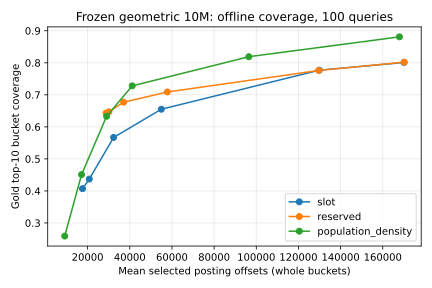

# Frozen geometric routing study

Read-only reconstruction uses actual router binaries, posting boundaries, numeric external/internal mappings and40 validated insertion-lineage publications. Native Float32 accumulation order and cosine preprocessing are reproduced. Baseline selected-vector counts and scorer-call counts match100/100 original queries. Numeric mappings are decoded using the native immutable13-byte entry format; posting offsets are never assumed to equal external IDs. Baseline oracle rows0–99, one-based external IDs, full10,120,191 population. No size-tiered experiment was run.

Source: `frozen_routing.py`. Raw outputs: `<admin>/experiments/2026-11-12-dli-architecture/continuation-26/geometric-routing/{routing.csv,summary.json,probabilities.npz,model-diagnostic.json}`. Probabilities file also includes raw logits. The dataset/gold remain continuation25/data. The100 queries are exploratory diagnostics, not a validation/test split for a tuned claim.

| Policy / requested minimum | Mean selected offsets | Models/query | Model-scope top10 | Bucket top10 |
|---|---:|---:|---:|---:|
|Slot /2K|17,586|1.01|.600|.407|
|Slot /20K|32,340|—|.812|.567|
|Reserved /2K|28,750|4.00|.987|.643|
|Reserved /20K|37,096|—|.988|.677|
|Density /2K|9,130|1.64|.436|.259|
|Density /20K|29,007|—|.926|.633|
|Density /30K|41,154|—|.981|.728|

These are selected-offset counts and gold inclusion statistics. They are not revised native Recall@10 or latency. Baseline native recall is .402, versus bucket inclusion .407; rounding/ranking precision and scoring should be checked before interpreting that small residual. Scope coverage only asks whether a neighbor belongs to a touched physical member. Bucket coverage additionally requires its actual posting bucket to be selected.



Reserved coverage chooses the highest-probability nonempty bucket from every learned physical member, then fills remaining work in baseline order. It reserves learned members, not the whole120K Plain buffer; Plain remains a normally ranked candidate. Whole buckets impose a substantial cost floor. `RoutingPolicy::ReservedPerLevel` is explicit opt-in; `SlotWeighted` remains default. Native scoring, visibility checks, pinned generations and exact fallback remain shared.

The offline density heuristic ranks `P(bucket|q)*member_population/bucket_population`, with Plain priority1. It fails at equal nominal budget but is competitive near29K actual offsets. It is not yet a runtime policy or calibrated estimator. Selecting a winner at nominal2000 alone would be scientifically misleading.

Sommerová, §3.5.1, printed pp39–40 / PDF51–52, derives `P*a^i` using a growing output count approximately`a^i`. Our models all have548 outputs. Under uniform uncertainty, baseline scores are`2^i/548`, not1. Logical-slot weighting therefore embeds a different prior in this implementation. This explains a structural bias; it does not establish a calibrated replacement. Local primary text: research-admin/.../sommerova.txt. Thesis: https://is.muni.cz/th/swimz/ . No MUNI source was copied.

At comparable work, reserved coverage beats slot weighting offline (.643 at28.8K versus .567 at32.3K). Held-out native recall/latency and cache-controlled repetition remain acceptance requirements; no default-policy change is justified yet.

Reproduction (read-only, no Qdrant process or training):

```bash
$CONDA_ENV/lmi-rust-inspect/bin/python research/dli/search_optimization/frozen_routing.py
$CONDA_ENV/lmi-starterpack/bin/python research/dli/search_optimization/plot_coverage.py <admin>/experiments/2026-11-12-dli-architecture/continuation-26/geometric-routing/routing.csv research/dli/search_optimization/bucket_coverage.svg
```

Experimental internal collection settings: `routing_policy: "ReservedPerLevel"`, `materialize_topk: true`; omit both for the preserved baseline. Neither changes compaction ownership or learned metadata generations. The collection remains restricted to its established supported single-shard dense Float16 cosine mode.

Native reserved/top-k bounded run PASS1/1 (161.71s including reopening): official query rows0–11, two identical rounds,24 learned/0 fallback,362,047 successful vector evaluations per round (30,171/query), Recall10=.633333/Recall30=.572222 in both. First/repeated p50=7331.69/213.38ms in debug. This validates execution of the reserved policy on the retained four-model topology; it is not the100-query offline estimate or release-mode latency. Raw continuation26/frozen-reserved-debug/{rounds.json}, frozen-reserved-debug.log, reserved-native-deltas.json.

## Same-row native routing control

Both variants use top-k materialization, identical retained physical generations and official rows0–11. Each executes two12-query rounds,24 learned/zero fallback. Only the routing policy changes; the original nominal minimum2000 remains equal, actual work differs.

|Policy|Recall10|Recall30|Vectors scored/query|Repeated-pass p50 ms (debug)|
|---|---:|---:|---:|---:|
|Slot|.383333|.352778|19,010.9|115.43|
|Reserved|.633333|.572222|30,170.6|213.38|

Reserved improves recall while scoring58.7% more vectors. This is **not** a matched-work speed or Pareto win in native execution. The same-row quality comparison is directly executed; the offline roughly-matched-work coverage comparison remains a separate result. Across-process ordering/cache effects and the small debug sample preclude a causal latency ratio. Both also show much slower first passes. Slot run PASS1/1,134.30s including reopen. Raw `continuation-26/frozen-slot12-debug/rounds.json`, `frozen-slot12-debug.log`, `native-routing-comparison.json`.
