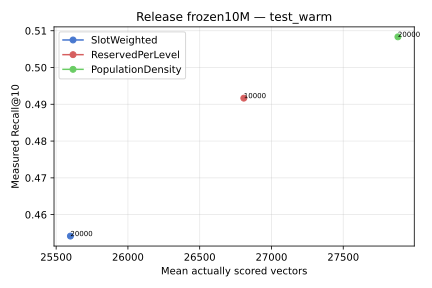
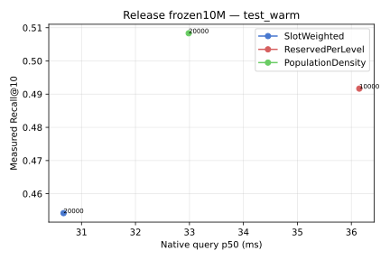
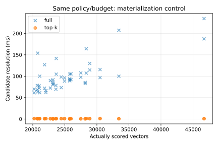
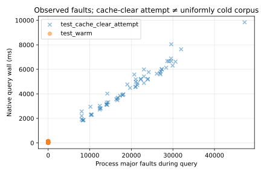

# Frozen geometric10M: release routing and materialization results

The controlled pilot completed **480 learned queries, zero fallback**, against10120191 retained vectors. No ingestion, training, compaction or hierarchy change occurred. The native study passed in421.06s, after a13m57s optimized build and24 passing release safety tests. Executed repository revision: **1e4d09a23** (native implementation checkpoint d8ad7a8e3). Later priority-cache measurements are a separate experiment, not part of these query timings.

Raw root: `/home/nicoo/research-admin/experiments/2026-11-12-dli-architecture/continuation-27/`. Native logs/results: `release-study/`. [Protocol and safety gate](06_MATCHED_WORK_RELEASE_STUDY.md), [all case metrics](matched_release_cases.csv). Reproduce with `run_release_matched_study.sh` using a fresh output directory.

## Actual-work comparison, held-out queries

Official2023 validation rows100–111 select the closest available actual-work30K and Recall10=.60 operating points; both objectives selected the same three configurations. Choices were locked before official held-out rows200–223. This is a small contiguous pilot, not a statistically representative10K-query campaign. The three test means differ by8.91%, satisfying the reported approximate-work comparison; they do not all hit exactly30K.

|Policy / minimum budget|Actual scores/query|Selected models/query|Buckets/query|Model-scope10|Bucket10 / final Recall10|Recall30|Warm p50 / p95 ms|
|---|---:|---:|---:|---:|---:|---:|---:|
|Slot /20K|25,599|1.96|2.25|.8667|.4542|.4347|30.67 /56.30|
|Reserved /10K|26,807|4.00|4.00|.9833|.4917|.4792|36.15 /117.76|
|Density /20K|27,881|3.38|4.50|.9542|.5083|.5014|32.99 /151.22|

All queries evaluate all four routers; selected-model counts above describe scoring, not inference calls. Actual native successful scoring counters are verified against executed posting selections for every query. Member and bucket coverage use persisted external/internal ID mappings and the **actual selected buckets**, not simulated routing. Bucket10 equals final Recall10 on these selected operating points.

Density gains5.42 percentage points Recall10 over slot while scoring8.91% more vectors. Its warm p50 is7.56% higher and p95 is substantially higher. Reserved improves member coverage, but roughly half of gold neighbors still miss the selected within-member buckets. **No cross-policy routing Pareto improvement is established.** Warm tails havezero major/minor faults in the inspected outliers; native scoring consumes most of the extra CPU. Their exact arithmetic/access/scheduling cause has not been isolated. Hybrid/vCPU placement is uncontrolled, not a demonstrated explanation.

### Recall matching failed to transfer

The validation-selected target=.60 did not produce a recall-matched service on held-out queries: Recall10 spread=.05417, Recall30 spread=.06667, and all selected test Recall10 values are below.60. Reserved's lowest tested validation point already reached.708, limiting quality matching on this coarse grid. Do not compare the latency values as equal-quality services. This does not prove no matched-recall point exists at other budgets. A larger independent validation sample/finer budget grid and fresh held-out queries are required for that claim; the current test set must not be retuned.

The full budget curves are validation curves, not held-out curves: [validation work](release_figures/recall-work-validation.svg), [validation latency](release_figures/recall-latency-validation.svg).

## Independent materialization factor: genuine bounded Pareto improvement

Identical slot20K policy, same24 test queries, same25,599 actual scores/query, same Recall10/30=.45417/.43472; warmup followed by full/top-k/full/top-k. All four measured passes havezero major faults.

|Mode / repetition|p50 ms|p95 ms|Mean scorer ms|Mean materialization ms|Mean resolver ms|Process CPU s /24 queries|
|---|---:|---:|---:|---:|---:|---:|
|Full1|138.17|279.75|20.31|19.50|108.40|3.69|
|Top-k1|24.95|38.30|19.76|.074|.599|.63|
|Full2|129.46|159.24|19.35|10.39|91.33|3.07|
|Top-k2|25.62|40.08|20.72|.084|.648|.66|

Materialized objects fall from25,599 to58.75/query. Native scoring is unchanged; the gain comes from avoiding full hit construction and membership-wide version work for candidates that cannot win. Across72 paired comparisons, all returned ID/score/version sets are identical.68 ordered lists match exactly; four reorder equal-score ties (queries206/223). Both native `ScoredPoint` and `ScoredPointOffset` order by score, without an ID tie-breaker. The initial over-strict ordered-list assertion was corrected only after checking that contract, equal score sequences and identical ID/score/version sets; it was not a visibility failure.

This is a measured release-mode improvement on the bounded frozen workload, not just the previous debug result. It does not prove dynamic throughput, crash safety, instrumentation-free timing or a universal5x speedup. Native update/deletion/deferred/proxy/stale-membership controls pass separately; genuine ambiguity and underfill still use complete native fallback.

## Cold-member access remains the large operational cost

Only the retained6M Cold member's vector cache is cleared through native APIs; Cached members remain Cached. The first pass is therefore a **Cold-member cache-clear attempt**, not a uniformly cold whole corpus.

|Policy|First-pass p50 /p95 ms|First-pass major faults /24|First-pass process CPU s /24|Warm major faults /24|Warm CPU s /24|
|---|---:|---:|---:|---:|---:|
|Slot|4877 /8045|441,904|12.95|0|.82|
|Reserved|3559 /6626|356,558|8.83|0|1.07|
|Density|4554 /6653|413,163|10.35|0|1.14|

The scorer dominates first-pass wall time; inference averages about5ms/query, far below seconds of access time. Warm native scoring still averages26.50/36.84/38.78ms, whereas top-k materialization is≤.18ms and resolution≤1.31ms for these three cases. The remaining warm bottleneck is inside native candidate scoring, not full result materialization. CPU uses process clock ticks (100Hz here), with coarse per-query resolution. Device bytes and fault file addresses were not measured.

Do not compare new warm30ms timings with the original3393b4a3c mixed/first-access3116ms and call it a100x algorithm improvement: queries, budgets, cache state and materialization differ. The paired materialization experiment is the valid direct baseline.

## Profile-driven planner optimization

Density planning repeatedly hashed UUIDs and divided inside its sort comparator. Priorities are immutable for a pinned query/generation, so the production planner now computes each once. Complete ordering and candidate counts match the previous production implementation across600 frozen-model frames/budgets and600 synthetic controls. Six alternating1000-call optimized repetitions on frozen predictions give median **1.20356→.47018ms/call (2.56x planner-only)**. Synthetic control gives2.31x. Full native regressions remain24 PASS/4 ignored. Source, input frame file, exact rustc commands, failed/fixed dependency logs and results are preserved as `continuation-27/planner-*`.

This correction is after the full query experiment; no end-to-end query speedup for it is claimed. It addresses measured density planning overhead without changing selected work or native visibility. It does not solve the much larger scorer/I/O cost.

## Calibrated allocation: useful hypothesis, not accepted native improvement

A separate frozen-model offline test fits one temperature and member priors on official rows100–199, then evaluates rows200–299. Targets are gold-neighbor posting buckets, **not retained teacher labels**. Validation neighbor-bucket NLL drops1.9577→1.4335 at T=2. Budgets are chosen on validation only.

|Offline method|Held-out selected offsets|Gold bucket10|Gold bucket30|
|---|---:|---:|---:|
|Density|35,161|.646|.618|
|T=2 plus fitted member priors|32,714|.653|.6243|

This is6.96% less selected work and+.007 bucket10, but an exploratory paired query bootstrap gives95% interval[-.015,.028] for the coverage change. Temperature and priors change together, so their separate causal effects are unknown. These are offline inclusion statistics, not native recall/latency. No calibration is enabled in the runtime and no neural model is retrained. Raw `offline-calibration/{calibration.json,bootstrap.json,rows.json,logits.npz}`; reproduction `offline_temperature.py FRESH_OUTPUT`.

Teacher centers/labels are absent from saved models. The observed member/bucket gap demonstrates a within-member limitation, but cannot separate teacher partition quality from neural approximation. Increasing capacity or retraining10M is not justified from this pilot alone.

## Integrity, limits and recommendation

The postprocessor checks all14,400 returned versions against the recorded41-batch insertion stream, independently cross-checks14,396 against immutable native version files, and checks every score against raw Float16 vectors/query cosine. Maximum error=.000396<the predeclared.0005 tolerance. Plain tracker files are not independently decoded. Full topology/config hashes remain unchanged, and there are no native optimization events. Official HDF5/raw equality is rechecked on rows100–299; manifests retain the official10M corpus and gold identity.

The sample is12 validation and24 held-out queries with fixed policy order, not randomized execution or multiple model seeds. Detailed tracing overhead is not separately quantified. CPU-only tail variability, complete recall matching, instrumentation-free replication and teacher diagnostics remain open. Peak RSS, write latency, static-LMI10M and HNSW are not measured here. No power-loss guarantees are added.

**Recommendation:** retain the proven top-k path as an experimental option and the cached-priority correction. Preserve slot routing as the control. Reserved/density policies improve coverage at roughly comparable scoring, but do not yet justify a new default or a routing breakthrough. Resolve scorer/access costs and validate larger recall-matched held-out operating points before any new ingestion/retraining campaign. The run completed within the active managed session; unsupported independent detachment was not claimed, and no experiment remains active.
